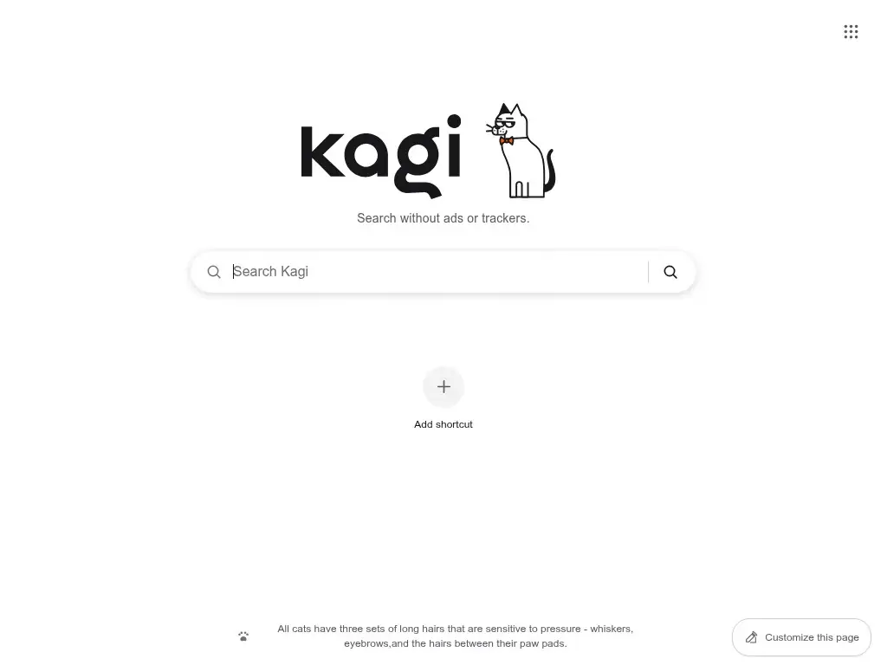

# Kagi Homepage

A Chrome-inspired browser start page for Kagi users, with direct search, custom shortcuts, and Kagi's official branding.

**Live page:** <https://jean-couscous.github.io/Browser-Homepage/>

  

## Features

- Submit searches directly to Kagi without saving queries or search history.
- Add and remove up to 10 custom shortcuts, stored only in your browser.
- Automatically detect site-hosted SVG, PNG, and ICO shortcut favicons, with DuckDuckGo and a colored initial as fallbacks.
- Use light, dark, or system themes based on Kagi's official palette.
- Use your own photo as the background, or no background at all, with an adjustable blur.
- Show or hide shortcuts from the customization panel.
- Switch between cats and dogs from the customization panel; Doggo shows in dog mode and Katto in cat mode.
- Focus search instantly with `/`.
- Browse Kagi apps.

## Install

Nothing to install: open the [live page](https://jean-couscous.github.io/Browser-Homepage/) and set it as your browser's startup page. It runs from GitHub Pages with no build step.

To run it offline instead, download or copy this project to a folder on your computer and open `index.html`. No dependencies, accounts, or build tools are needed either way.

## Use as Chrome's startup page

1. Open <https://jean-couscous.github.io/Browser-Homepage/> in Chrome.
2. Open **Settings → On startup → Open a specific page or set of pages**.
3. Add the URL as a startup page.

Settings and shortcuts are stored per site in `localStorage`, so a configuration made from a local `file://` copy does not carry over to the hosted page; add your shortcuts once on the hosted URL and they persist there.

Chrome reserves its built-in new-tab page for browser extensions. Replacing every new tab, rather than only the startup page, requires a separate new-tab extension. Ungoogled-Chromium has a custom new tab flag.

## Keyboard shortcuts

| Key | Action |
| --- | --- |
| `/` | Focus the search field |
| `Escape` | Close open menus and dialogs |

## Privacy

Preferences, shortcuts, and any custom background image stay in the browser's local storage. Shortcut icons are requested from each website first, then from DuckDuckGo's favicon service if the website's icon is unavailable. If both requests fail or the browser is offline, the shortcut keeps its colored initial. Search queries are sent directly to Kagi only when you search and are never saved by the homepage. A background image you pick is resized inside the browser, never uploaded.
