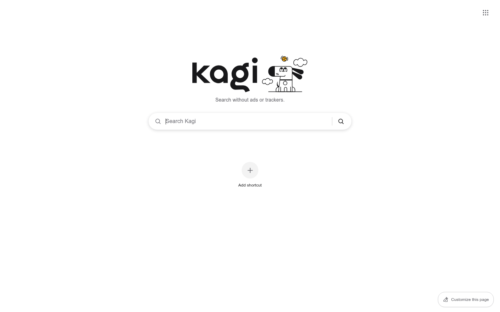

# Kagi Homepage

A Chrome-inspired browser start page for Kagi users, with direct search, custom shortcuts, and Kagi's official branding.

  

## Features

- Submit searches directly to Kagi without saving queries or search history.
- Add and remove up to 10 custom shortcuts, stored only in your browser.
- Automatically detect site-hosted SVG, PNG, and ICO shortcut favicons, with DuckDuckGo and a colored initial as fallbacks.
- Use light, dark, or system themes based on Kagi's official palette.
- Choose from Unsplash background photos or no background, with an adjustable blur.
- Show or hide shortcuts from the customization panel.
- Focus search instantly with `/`.
- Browse Kagi apps.

## Install

Download or copy this project to a folder on your computer. Everything required is included: there are no dependencies, accounts, build tools, or external assets required to open the homepage.

## Use as Chrome's startup page

1. Open `index.html` in Chrome and copy its local `file://` URL from the address bar.
2. Open **Settings → On startup → Open a specific page or set of pages**.
3. Add the copied URL as a startup page.

Chrome reserves its built-in new-tab page for browser extensions. Replacing every new tab, rather than only the startup page, requires a separate new-tab extension. Ungoogled-Chromium has a custom new tab flag.

## Keyboard shortcuts

| Key | Action |
| --- | --- |
| `/` | Focus the search field |
| `Escape` | Close open menus and dialogs |

## Privacy

Preferences and shortcuts stay in the browser's local storage. Shortcut icons are requested from each website first, then from DuckDuckGo's favicon service if the website's icon is unavailable. If both requests fail or the browser is offline, the shortcut keeps its colored initial. Search queries are sent directly to Kagi only when you search and are never saved by the homepage. Background photos are requested from Unsplash when a background is selected.
